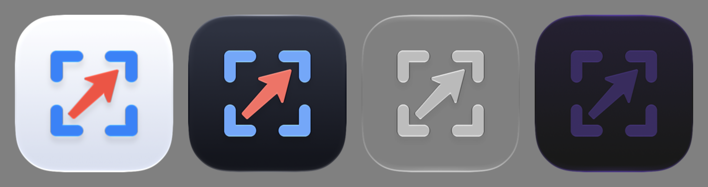

# Clip

[](https://github.com/arhea/Clip/actions/workflows/ci.yml)
[](LICENSE)


A fast, native screenshot and annotation tool for macOS. Capture an area, window, or screen, mark it up, and get it where it needs to go — without leaving the keyboard.

Clip is written in Swift 6 and SwiftUI, lives in the menu bar, and has no third-party dependencies.



## Features

### Capture

- **Area:** drag to select, with a frozen screen, crosshair, magnifier loupe, and a live pixel-size label. Hold ⇧ for a square, ⌥ to draw from the center. Space switches to window mode, Esc cancels. A click without a drag captures the window under the pointer.
- **Window:** one window on a transparent background, with the shadow optional.
- **Fullscreen:** the display under the pointer.
- **All Screens:** every display stitched into one image.
- **Previous Area:** re-capture the last selection.
- **Self-timer:** 3, 5, or 10 seconds.
- **Capture Text (OCR):** on-device text recognition, copied straight to the clipboard.
- Multi-monitor aware, including mixed Retina and non-Retina displays.

### After capture

- **Default action** (Settings → General): copy to clipboard, open in the editor, or save to disk (`~/Documents/ClipScreenshots` by default).
- **Then show** one of:
  - **Notification** (default): a thumbnail with the remaining actions — Open in Editor, Save to Disk, Copy, Show in Finder. Click it to open the editor.
  - **Quick Access overlay:** a floating thumbnail with Copy, Save, Annotate, Pin, and Delete. Drag it straight into other apps.
  - **Nothing.**

### Editor

| Tool | Key | Tool | Key |
| --- | --- | --- | --- |
| Select | V | Text (plain, outlined, background, pill) | T |
| Crop, with aspect presets | K | Draw | D |
| Arrow (tapered, classic, filled, double) | A | Highlighter | M |
| Line | L | Counter | C |
| Rectangle | R | Pixelate, blur, or black out | P |
| Filled rectangle | F | Spotlight | H |
| Ellipse | E | Background | B |

- **Background:** gradient or solid fill, padding, inset, rounded corners, drop shadow, aspect ratio, and 9-point alignment.
- **Transform:** rotate and flip.
- **Resize and compress:** PNG, JPEG, or HEIC; quality slider; exact width × height with aspect lock; percentage presets; Non-Retina (1×) output; estimated file size.
- **Output:** copy (⇧⌘C), save (⌘S), save as (⇧⌘S), drag out, or pin.
- **Editing:** undo/redo, duplicate (⌘D), layer order (⇧⌘[ / ⇧⌘]), arrow-key nudging.
- **Non-destructive:** edits are saved with the history item, so you can reopen a capture and keep working.

### Everything else

- **Menu bar app** with no Dock icon.
- **History** of the last 50 captures: filter by type, then copy, save, annotate, pin, reveal in Finder, delete, or drag out.
- **Pins:** always-on-top screenshots. Scroll for opacity, ⌘-scroll or pinch to zoom, lock for click-through.
- **Rebindable global shortcuts** via Carbon `RegisterEventHotKey` — no Accessibility permission required.
- Light and dark mode, with Liquid Glass surfaces.

## Default shortcuts

| Action | Shortcut |
| --- | --- |
| Capture Area | ⌥⇧4 |
| Capture Window | ⌥⇧5 |
| Capture Fullscreen | ⌥⇧3 |
| Capture Previous Area | ⌥⇧6 |
| Open History | ⌥⇧H |

Change any of these in Settings → Shortcuts.

## Install

There are no prebuilt releases yet. Build from source:

### Requirements

- macOS 26 or later
- Xcode 26 or later
- [XcodeGen](https://github.com/yonaskolb/XcodeGen): `brew install xcodegen`

### Build and run

```sh
git clone git@github.com:arhea/Clip.git
cd Clip
xcodegen generate
open Clip.xcodeproj
```

Or from the command line:

```sh
xcodebuild -scheme Clip -derivedDataPath build build
xcodebuild -scheme Clip -derivedDataPath build test
```

Only `project.yml` is checked in. `Clip.xcodeproj` is generated — rerun `xcodegen generate` after adding or removing files.

### Screen Recording permission

Clip needs **Screen & System Audio Recording** permission (System Settings → Privacy & Security). macOS ties that grant to the app's code signature. Ad-hoc builds, the default, get a new identity on every build, so you may need to re-grant after rebuilding.

To keep the permission stable, sign with your own Apple Developer team. Create `Config/Signing.xcconfig` (git-ignored):

```
DEVELOPMENT_TEAM = YOURTEAMID
CODE_SIGN_IDENTITY = Apple Development
```

## Architecture

```
Clip/
  App/           ClipApp (MenuBarExtra + Settings), AppState coordinator, menu
  Capture/       ScreenCaptureKit wrapper, multi-display selection overlay
  Editor/        Annotation model, EditorDocument (undo), Renderer, canvas, UI
  History/       HistoryStore (Application Support/Clip/History), history window
  QuickAccess/   Post-capture floating thumbnails
  Pin/           Floating pinned screenshots
  Settings/      Preferences (UserDefaults) and Settings UI
  Support/       Hot keys, export/encoding, geometry, HUD
ClipTests/       Swift Testing unit tests
```

Key design decisions:

- **One renderer.** `Renderer` draws the document into any top-left-origin `CGContext`. The live SwiftUI `Canvas` and the exported file both go through it, so what you see is what gets saved.
- **Pixel-space annotations.** Annotations are value types in base-image pixel coordinates. Crop, background, zoom, and export are transforms applied at render time, which keeps edits non-destructive and serializable (`EditorProject`).
- **Undo by snapshot.** `EditorState` is a small value type. Undo and redo are snapshot stacks, and continuous drags collapse into a single undo step.
- **Swift 6, main-actor by default** (`SWIFT_DEFAULT_ACTOR_ISOLATION = MainActor`, strict concurrency). Pure model and geometry types are `nonisolated`.

## Roadmap

See [docs/feature-status.md](docs/feature-status.md) for what's shipped and what's open. Next up:

- **Screen recording (MP4/GIF):** `ScreenCapturer` already builds `SCContentFilter`s; recording will reuse them with `SCStream` and `AVAssetWriter`, plus the existing selection overlay for choosing a region.
- Scrolling capture, auto-applied background presets, custom wallpaper backgrounds, WebP export, and combining images.

## Contributing

Issues and pull requests are welcome. Before opening a PR:

1. Run `xcodegen generate` and make sure `xcodebuild -scheme Clip test` passes.
2. Keep changes focused — one concern per PR.
3. Match the existing style: Swift 6 strict concurrency, no third-party dependencies.

## License

[MIT](LICENSE)
